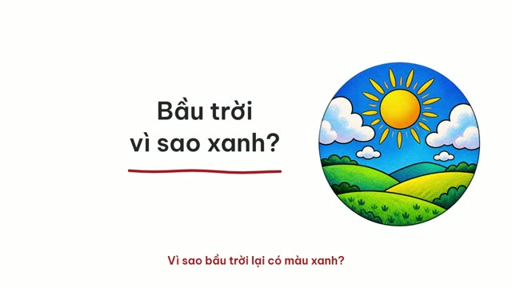
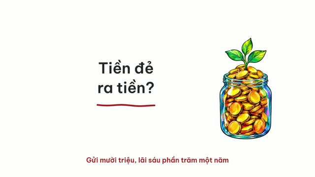
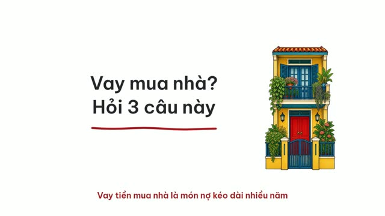
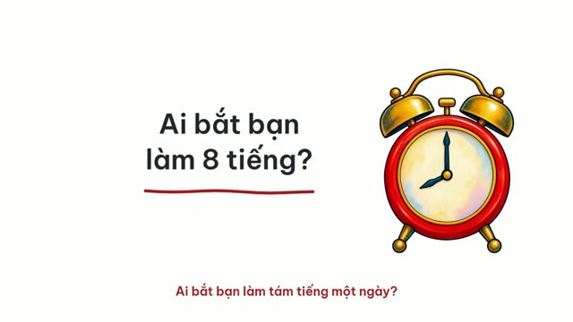
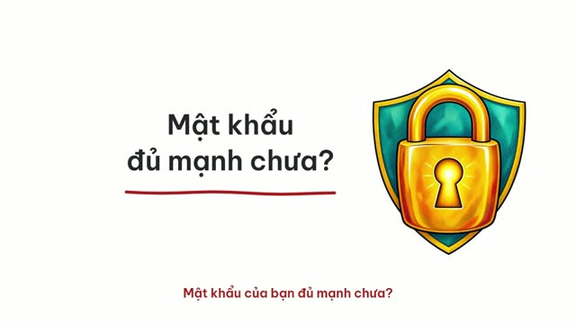

<div align="center">

# Sketchcast

**Video vẽ tay tiếng Việt, chỉ cần gõ một câu trong Claude Code**

Nét mực vẽ dần theo lời đọc · tô màu · phụ đề · nhạc nền · âm thanh · bản ngang 16:9 và bản dọc 9:16

<a href="https://github.com/ducloc99/sketchcast/releases/download/v1.0.0/sketchcast-intro.mp4"></a>

▶ [Xem video giới thiệu đầy đủ (2 phút, có tiếng)](https://github.com/ducloc99/sketchcast/releases/download/v1.0.0/sketchcast-intro.mp4)

</div>

## Sketchcast làm được gì

Bạn nói chủ đề, ví dụ *"làm video về lãi kép"*. Claude sẽ:

1. **Tìm hiểu chủ đề** trên web, ghi lại nguồn cho từng con số
2. **Viết kịch bản**, rồi tự chấm hai vòng: một "người xem lạ" chấm xem có dễ hiểu, có cuốn không, và một "người kiểm chứng" soát xem từng câu có khớp nguồn không
3. **Đọc giọng tiếng Việt** tự nhiên, tự nghe lại để bắt chỗ đọc sai
4. **Vẽ đồ vật** theo phong cách vẽ tay, rồi cho nét mực hiện dần đúng lúc giọng nhắc tới
5. **Dàn trang, thêm hiệu ứng**: trang mở đầu, số đếm, biểu đồ, dòng thời gian, khoanh tròn, gạch chân, tua năm
6. **Xuất video** 16:9 cho YouTube/Facebook và bản dọc 9:16 cho Reels/TikTok/Shorts, kèm caption và bình luận ghim nguồn

Chữ trên hình do code viết nên luôn đúng dấu tiếng Việt. AI không tự vẽ chữ hay logo.

## Video mẫu theo ngành

Mỗi video khoảng 30 giây, làm hoàn toàn bằng Sketchcast. Bấm vào ảnh để xem.

| | | |
|:-:|:-:|:-:|
| [](https://github.com/ducloc99/sketchcast/releases/download/v1.0.0/giao-duc.mp4)<br>**Giáo dục**<br>Vì sao bầu trời màu xanh? | [](https://github.com/ducloc99/sketchcast/releases/download/v1.0.0/tai-chinh.mp4)<br>**Tài chính**<br>Lãi kép: tiền đẻ ra tiền | [](https://github.com/ducloc99/sketchcast/releases/download/v1.0.0/y-te.mp4)<br>**Y tế**<br>Vắc-xin hoạt động thế nào? |
| [](https://github.com/ducloc99/sketchcast/releases/download/v1.0.0/bat-dong-san.mp4)<br>**Bất động sản**<br>Vay mua nhà: hỏi 3 câu | [](https://github.com/ducloc99/sketchcast/releases/download/v1.0.0/luat.mp4)<br>**Luật, nhân sự**<br>Thử việc: luật nói gì? | [](https://github.com/ducloc99/sketchcast/releases/download/v1.0.0/ban-hang.mp4)<br>**Bán hàng online**<br>Vì sao bình giữ nhiệt giữ nóng lâu? |
| [](https://github.com/ducloc99/sketchcast/releases/download/v1.0.0/doanh-nghiep.mp4)<br>**Doanh nghiệp**<br>Khách phàn nàn: 3 bước xử lý | [](https://github.com/ducloc99/sketchcast/releases/download/v1.0.0/du-lich.mp4)<br>**Du lịch**<br>Vịnh Hạ Long có gì đặc biệt? | [](https://github.com/ducloc99/sketchcast/releases/download/v1.0.0/tin-tuc.mp4)<br>**Tin tức**<br>Ai bắt bạn làm 8 tiếng? |
| [](https://github.com/ducloc99/sketchcast/releases/download/v1.0.0/cong-nghe.mp4)<br>**Công nghệ**<br>Mật khẩu mạnh trông thế nào? | | |

## Cài nhanh: dán một câu vào Claude Code

Mở Claude Code ở bất kỳ đâu và gõ:

```
Cài skill này rồi hướng dẫn mình dùng: https://github.com/ducloc99/sketchcast
```

Claude sẽ tải về, cài đặt, hướng dẫn bạn lấy khoá kie.ai, dựng thử một video mẫu (không tốn credit) rồi bắt đầu làm video. Từ lần sau, mở Claude Code ở thư mục `sketchcast` vừa tạo.

## Hoặc tự tải về trong 3 bước

**1. Tải thư mục về máy**

Bấm nút xanh **Code → Download ZIP** ở đầu trang này rồi giải nén. Hoặc dùng lệnh:

```bash
git clone https://github.com/ducloc99/sketchcast.git
```

**2. Mở thư mục bằng Claude Code**

Mở [Claude Code](https://claude.com/claude-code) (ứng dụng máy tính, hoặc gõ `claude` trong terminal) và chọn thư mục `sketchcast` vừa tải.

**3. Gõ câu này vào khung chat**

```
Đọc file CLAUDE.md và hướng dẫn mình bắt đầu
```

Sau đó chỉ cần nói chủ đề, ví dụ `Làm video về lãi kép`. Hướng dẫn đầy đủ từng bước cho người mới: [HUONG-DAN.txt](HUONG-DAN.txt).

Lần đầu, Claude sẽ tự kiểm tra máy, cài những gì còn thiếu (có hỏi bạn trước) và hỏi vài câu về kênh của bạn. Bạn chỉ cần tự dán khoá kie.ai vào file `.env` khi được nhắc.

## Dành cho Claude (khi được nhờ cài từ link này)

1. Hỏi người dùng muốn để thư mục ở đâu (mặc định: thư mục Documents của họ). Tải về: `git clone https://github.com/ducloc99/sketchcast.git` (không có git thì tải https://github.com/ducloc99/sketchcast/archive/refs/heads/main.zip rồi giải nén, đổi tên thành `sketchcast`).
2. Mọi lệnh sau đó chạy **bên trong** thư mục `sketchcast` vừa tải. Đọc `CLAUDE.md` và `.claude/skills/sketchcast/SKILL.md` trong đó, làm hết mục "Lần đầu dùng".
3. Xong thì dặn người dùng: từ lần sau, mở Claude Code ở đúng thư mục `sketchcast` này để Claude tự nhận skill. Đừng chép riêng skill ra chỗ khác: skill cần cả thư mục (giao diện `brand/`, `kenh.md`, `videos/`).

## Cần chuẩn bị

| Thứ cần có | Để làm gì |
|---|---|
| [Claude Code](https://claude.com/claude-code) | Bộ não điều khiển cả quy trình |
| Tài khoản [kie.ai](https://kie.ai) có credit | Vẽ đồ vật (GPT Image), đọc giọng (Gemini TTS), tạo nhạc nếu muốn (Suno). Lấy khoá tại [kie.ai/api-key](https://kie.ai/api-key) |
| Node.js 18+, ffmpeg, Python 3.10+ | Dựng và xuất video trên máy bạn. Claude sẽ chỉ cách cài nếu thiếu |

**Chi phí:** 10 video mẫu ở trên (mỗi video khoảng 30 giây) tốn 30 đến 53 credit kie.ai mỗi video, khoảng 0,15 đến 0,26 USD. Video dài hơn tốn nhiều hơn, tuỳ số cảnh. Sau mỗi video, Claude báo số credit đã dùng.

## Làm cho hợp kênh của bạn

- **`kenh.md`**: kênh nói chuyện với ai, lời hứa của kênh, cách kết video, hashtag. Claude hỏi bạn và điền ở lần đầu.
- **`brand/style.json`**: màu chủ đạo, font, kiểu bút (đốm sáng hay bàn tay cầm bút), phong cách vẽ, loại giấy.
- **`brand/music/nhac-kenh.mp3`**: nhạc nền dùng chung cho mọi video. Chép một bài bạn có quyền dùng, hoặc nhờ Claude tạo bằng AI.
- **`brand/sfx/`**: 18 âm thanh hiệu ứng (con dấu, chuông, lật giấy, tiền xu...), tất cả dùng tự do.

Muốn đổi gì, cứ nói với Claude bằng lời thường: *"đổi màu chủ đạo sang xanh lá"*, *"dùng bàn tay cầm bút thay cho đốm sáng"*.

## Câu lệnh hay dùng

| Bạn gõ | Claude làm |
|---|---|
| `Làm video về <chủ đề>` | Làm trọn từ tìm hiểu đến xuất video |
| `Viết kịch bản về <chủ đề>, cho mình duyệt trước` | Dừng lại sau kịch bản để bạn xem |
| `Làm reel 45 giây về <chủ đề>` | Chỉ làm bản dọc |
| `Làm lại cảnh 3, vẽ to hơn` | Sửa một cảnh rồi xuất lại |
| `Làm video giống mẫu tài chính, chủ đề <...>` | Dùng một trong 10 mẫu có sẵn làm khuôn |

## Lưu ý

- Hãy xem lại video trước khi đăng, nhất là cách đọc tên riêng và con số. Nguồn của từng dữ kiện nằm trong `research.md` của mỗi video và trong bình luận ghim.
- Video chứa hình do AI vẽ. Tuỳ nền tảng, bạn có thể cần đánh dấu "nội dung tạo bằng AI" khi đăng.

## Giấy phép

Code: [MIT](LICENSE), bạn được dùng, sửa và dùng cho mục đích thương mại. Font Be Vietnam Pro và Patrick Hand theo SIL Open Font License. Nguồn âm thanh: [CREDITS.md](.claude/skills/sketchcast/assets/CREDITS.md).

---

<details>
<summary><b>English</b></summary>

**Sketchcast** is a Claude Code skill that turns one sentence into a hand-drawn explainer video in Vietnamese: ink strokes drawn in sync with the voice-over, pastel colouring, karaoke captions, music and sound effects, in 16:9 plus a 9:16 cut for Reels/TikTok/Shorts. It researches the topic, writes and self-reviews the script (a cold reader and a fact checker), voices it, draws the objects, lays out every scene and renders the video.

1. Download this repo (Code → Download ZIP, or `git clone`).
2. Open the folder in Claude Code.
3. Type `Đọc file CLAUDE.md và hướng dẫn mình bắt đầu` (or just paste the repo link into Claude Code and ask it to install the skill), then `Làm video về <topic>` ("make a video about ..."). On first run Claude checks your machine and asks you to paste a [kie.ai](https://kie.ai) API key into `.env`.

Requires Node.js 18+, ffmpeg, Python 3.10+ and kie.ai credits (about 30 to 53 credits, US$0.15 to 0.26, for each 30-second sample above). MIT licensed.

</details>
